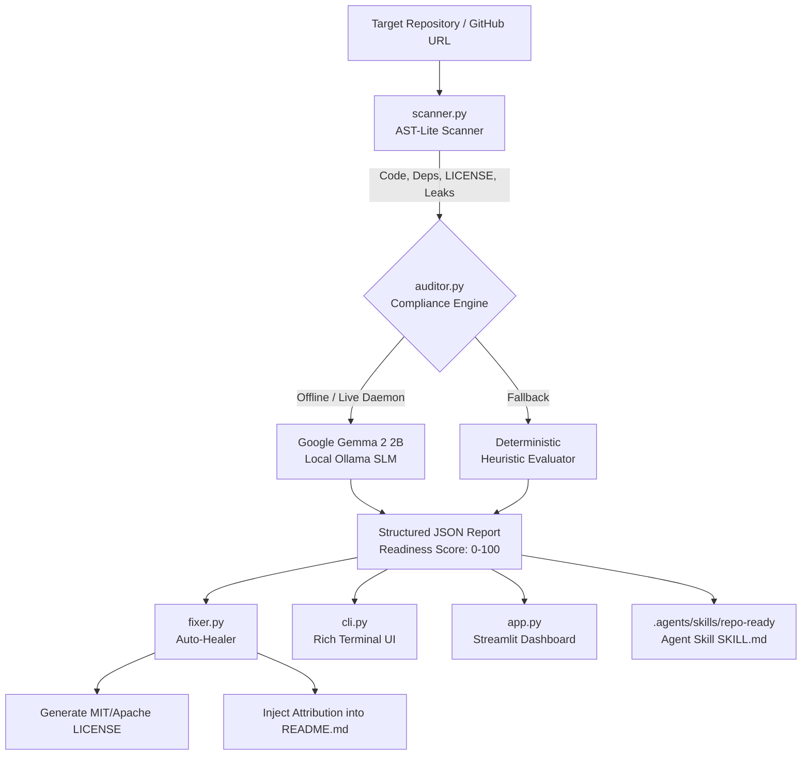

# 🛡️ RepoReady (`repo-ready`)
### Open-Weight AI Compliance Auditor, Auto-Fixer & Universal Agent Skill

[](./LICENSE)
[-blue.svg)](https://huggingface.co/google/gemma-2-2b-it)
[](./.agents/skills/repo-ready/SKILL.md)
[](#-open-weight-model--licensing-attribution)

> **RepoReady** is an open-source developer tool built for **Hacktoberfest** that audits Git repositories for open-source license compliance, detects open-weight AI model weights in code, and automatically injects missing LICENSE files and legal attribution blocks into `README.md`.

---

## 🚀 Why RepoReady?

The #1 trap in AI hackathons: **confusing open-source code licenses with open-weight model terms**.
Using weights like **Google Gemma** or **Meta Llama** under an MIT license without explicitly linking their provider Terms of Use violates challenge rules and model licenses.

RepoReady solves this across three unified interfaces:
1. **Universal Agent Skill (`SKILL.md`)**: Runs natively inside **Google Antigravity**, **OpenCode**, and Claude/Cursor agents.
2. **Terminal CLI (`cli.py`)**: Cyber-styled Rich terminal UI with animations, tables, and `--fix` flags.
3. **Web Dashboard (`app.py`)**: Dark-mode Streamlit dashboard with 0–100 gauge, side-by-side diffs, and 1-click healing.

---

## 🏗️ System Architecture



---

## 🧠 Open-Weight Model & Licensing Attribution

> **Notice on Open-Weight vs. Open-Source Terms (Hacktoberfest Compliance):**  
> - **Source Code License:** The source code of RepoReady is released under the permissive [MIT License](./LICENSE).  
> - **AI Model Weights:** This project is powered locally by **Google Gemma 2 (`gemma-2-2b-it` / `gemma2:2b`)**, a **2.6 Billion parameter Small Language Model (SLM $\le 10\text{B}$)**.  
> - Model weights are governed by the **Gemma Terms of Use** and are not subject to the MIT code license.

| Model Name | Parameter Count | Category | Provider | Official Terms / Card |
| :--- | :--- | :--- | :--- | :--- |
| **Google Gemma 2** (`gemma2:2b`) | **2.6 Billion** | Open-Weight SLM ($\le 10\text{B}$) | Google DeepMind | [Gemma Terms of Use](https://ai.google.dev/gemma/terms) • [Hugging Face](https://huggingface.co/google/gemma-2-2b-it) |
| **Meta Llama 3** *(Optional)* | 3.2 Billion | Open-Weight SLM | Meta | [Llama 3 License](https://llama.meta.com/llama3/license/) • [Hugging Face](https://huggingface.co/meta-llama/Llama-3.2-3B) |
| **Mistral / Mixtral** *(Optional)* | 7.0 Billion | Open-Weight LLM | Mistral AI | [Mistral Terms of Use](https://mistral.ai/terms/) • [Hugging Face](https://huggingface.co/mistralai/Mistral-7B-Instruct-v0.3) |

---

## ⚡ 60-Second Quickstart for Judges

### 1. Prerequisites
- Python 3.10+
- *(Optional)* [Ollama](https://ollama.com) for live local Gemma 2 inference. If Ollama is not running, RepoReady seamlessly activates its deterministic fallback engine.

```bash
# Optional: Pull local Gemma 2 (2.6B params, ~1.6GB)
ollama pull gemma2:2b
```

### 2. Installation
```bash
# Clone the repository
git clone https://github.com/monish/repo-ready.git
cd repo-ready

# Create and activate virtual environment
python -m venv venv
# Windows:
venv\Scripts\activate
# Linux/macOS:
source venv/bin/activate

# Install dependencies
pip install -r requirements.txt
```

### 3. Run the Live Demo on Broken Test Repo
RepoReady includes a pre-packaged test folder (`demo_broken_project`) containing uncredited Gemma/Llama weights, a false MIT claim, and leaked keys.

```bash
# Run terminal audit (Score: 20/100)
python cli.py ./demo_broken_project

# Auto-fix the broken repo in 1 second
python cli.py ./demo_broken_project --fix

# Re-run audit to verify auto-remediation!
python cli.py ./demo_broken_project
```

### 4. Launch the Interactive Web Dashboard
```bash
streamlit run app.py
```
Open [http://localhost:8501](http://localhost:8501) in your browser. Click **"Load Broken Demo Repo (Judge Test)"** in the sidebar to run the visual live audit and side-by-side diff auto-fixer!

### 5. Invoke as an Agent Skill in Antigravity or OpenCode
RepoReady adheres to the official **Agent Skills Open Standard**:
- Location: `.agents/skills/repo-ready/SKILL.md`
- In your agent chat (Google Antigravity, OpenCode, Claude/Cursor), simply ask:  
  `"Audit this repository for open-weight compliance using repo-ready"`

---

## 🐳 Docker Quickstart

```bash
# Build the container
docker build -t repo-ready .

# Run the Streamlit web dashboard
docker run -p 8501:8501 repo-ready
```

---

## 📄 License
This project is licensed under the [MIT License](./LICENSE).  
Copyright (c) 2026 RepoReady Contributors.
